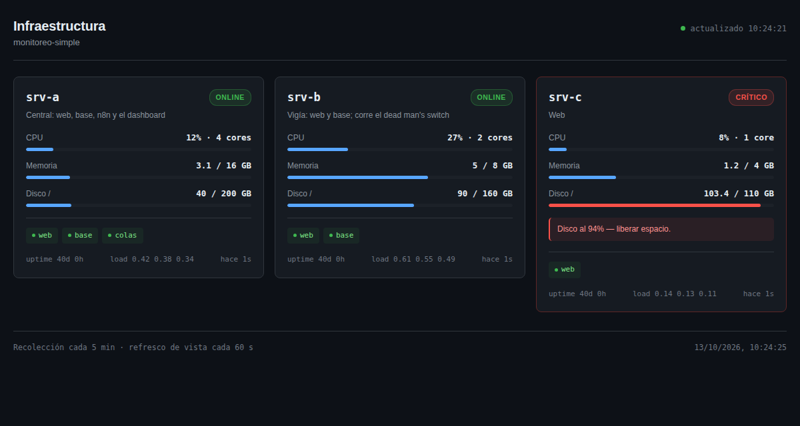

# monitoreo-simple

Monitoreo para pocos servidores Linux con bash, cron, SSH, nginx y n8n. Sin agentes ni base de datos.

- Cada servidor genera un JSON con su estado cada 5 minutos y lo empuja a un servidor central.
- El central muestra un **dashboard** y un workflow de **n8n** avisa por **Telegram** cuando algo *cambia*.
- Un segundo servidor vigila al central y, si se cae él, las alertas o n8n, avisa **por correo**. Es el *dead man's switch*.

**Lo que no es:** no es Prometheus ni Grafana. No guarda series ni dibuja gráficos: muestra la última foto de cada servidor y avisa de las transiciones. Está pensado para 2 a 10 servidores. Si tenés más, o necesitás historial y gráficos, usá node_exporter + Prometheus + Grafana o Netdata.



Para verlo sin instalar nada: `dashboard/demo.sh` y abrí http://localhost:8000/ (necesita python3 y jq).

---

## Arquitectura

```
  srv-b: vps-metrics.sh -> JSON -> ssh (clave con command=) --+
  srv-c: vps-metrics.sh -> JSON -> ssh (clave con command=) --+
  srv-a: vps-metrics.sh -> metrics-recv local ----------------+
                                                              |
                                                              v
                                            srv-a: /var/www/metrics/<host>.json
                                                    |                  |
                                                    v                  v
                                        nginx (auth_basic)     n8n cada 5 min
                                                    |                  |
                                                    v                  v
                                               dashboard      Telegram, sólo si algo cambió

  srv-b: dms-n8n.sh cada 5 min -> healthz de n8n + latido de las alertas
                                   |
                                   +-> si falla: correo, sin pasar por srv-a
```

- **srv-a, el central:** recibe los JSON y sirve el dashboard. También corre n8n.
- **srv-b, el vigía:** además de reportar como cualquier otro, vigila al central. Tiene que ser otro servidor: si el central se cae, no puede avisar de sí mismo.
- Los nombres son de ejemplo. Cada servidor se identifica por su `hostname -s`.

Las razones de cada decisión (push en vez de pull, transiciones en vez de estados, correo y no Telegram para el dead man's switch) están en [docs/decisiones.md](docs/decisiones.md).

---

## Requisitos

- Debian o Ubuntu con systemd en todos los servidores; bash, cron, coreutils, openssl y python3 (para validar el JSON en el central).
- SSH entre los servidores y el central.
- En el central: nginx con un vhost con HTTPS, y **n8n** con una credencial de un bot de Telegram.
- En el vigía: `curl`, `jq` y un MTA que pueda mandar correo (`mail` de mailutils o bsd-mailx funcionando).

---

## Archivos

| Archivo | Dónde va | Qué hace |
|---|---|---|
| `scripts/vps-metrics.sh` | todos → `/usr/local/bin/vps-metrics.sh` | recolecta CPU, RAM, disco, load, uptime, servicios y TLS |
| `scripts/metrics-push.sh` | todos → `/usr/local/bin/metrics-push` | recolecta y entrega al central |
| `scripts/metrics-recv.sh` | central → `/usr/local/bin/metrics-recv` | valida el JSON y lo publica |
| `scripts/dms-n8n.sh` | vigía → `/usr/local/bin/dms-n8n` | dead man's switch |
| `config/metrics.conf.example` | todos → `/etc/monitoreo/metrics.conf` | rol y servicios a vigilar |
| `config/push.env.example` | todos → `/etc/monitoreo/push.env` | cuál es el central y cómo llegar |
| `config/recv.env.example` | central → `/etc/monitoreo/recv.env` | hosts aceptados |
| `config/dms.env.example` | vigía → `/etc/monitoreo/dms.env` | URL de n8n, correo y token |
| `config/cron.d-*`, `config/logrotate-*` | según el nombre | cron y rotación de logs |
| `config/sshd-match-metrics.conf` | central → final de `sshd_config` | encierra al usuario `metrics` |
| `config/n8n-monitoreo-archivos.conf` | central → drop-in de systemd de n8n | deja a n8n leer las métricas |
| `dashboard/index.html` | central → `/var/www/infra/index.html` | la vista |
| `dashboard/nginx.conf.example` | central → `/etc/nginx/snippets/` | sirve el dashboard y los JSON |
| `n8n/alertas-infra.json` | importar en n8n | alertas por Telegram |
| `n8n/latido.json` | importar en n8n | webhook que consulta el vigía |

Los comandos de abajo asumen que copiaste el repo a `/tmp/monitoreo-simple` en el servidor donde corren (`scp -r` o `git clone`).

---

## Instalación

El orden importa: cada paso se apoya en el anterior, y cada uno termina con una verificación de solo lectura. **Si una verificación no da lo esperado, frená ahí.**

Si querés hacerlo con Claude (u otro asistente), arrancá la conversación con [PROMPT-CLAUDE.md](PROMPT-CLAUDE.md): lo obliga a ir de a un paso y a ver la salida real antes de seguir.

### 1. Relevar

En **cada** servidor, antes de tocar nada:

```bash
hostname -s; cat /etc/os-release | head -2
systemctl list-units --type=service --state=running --no-pager
```

Anotá el `hostname -s` de cada uno y qué servicios tienen que estar siempre corriendo. Con eso armás su `metrics.conf`. En el central, anotá además el puerto de SSH y cómo corre n8n (`systemctl status n8n` o Docker).

### 2. Recolector, en todos

```bash
sudo install -m 755 scripts/vps-metrics.sh /usr/local/bin/vps-metrics.sh
sudo install -d -m 755 /etc/monitoreo
sudo install -m 644 config/metrics.conf.example /etc/monitoreo/metrics.conf
sudo nano /etc/monitoreo/metrics.conf            # ROLE y SERVICES reales
sudo /usr/local/bin/vps-metrics.sh /tmp/prueba.json && cat /tmp/prueba.json
```

**Verificá:** que el JSON esté completo y que todos los servicios digan `"active"`. Un `"absent"` es un nombre de unidad mal escrito.

### 3. Receptor, en el central

`metrics` necesita una shell real: sshd ejecuta el `command=` a través de ella, y con `nologin` el push falla siempre. Lo que encierra a ese usuario no es la shell sino lo demás: la contraseña bloqueada, `command=…,restrict`, el `Match User` de sshd y un home que no puede modificar.

```bash
sudo useradd --system --no-create-home --home-dir /home/metrics --shell /bin/sh metrics
sudo passwd -l metrics
sudo install -d -o root -g root -m 755 /home/metrics /home/metrics/.ssh
sudo install -d -o metrics -g metrics -m 755 /var/www/metrics
# Opcional: historial NDJSON (sin rotación incluida, ~300 KB por host y por día)
# sudo install -d -o root -g root -m 755 /var/lib/monitoreo
# sudo install -d -o metrics -g metrics -m 750 /var/lib/monitoreo/activo

sudo install -m 755 scripts/metrics-recv.sh /usr/local/bin/metrics-recv
sudo install -m 755 scripts/metrics-push.sh /usr/local/bin/metrics-push
sudo install -m 644 config/recv.env.example /etc/monitoreo/recv.env
sudo install -m 644 config/push.env.example /etc/monitoreo/push.env
sudo nano /etc/monitoreo/recv.env /etc/monitoreo/push.env
sudo /usr/local/bin/metrics-push
```

**Verificá:** `sudo passwd -S metrics` dice `L` y `cat /var/www/metrics/$(hostname -s).json` muestra el JSON. Después instalá el cron y el logrotate:

```bash
sudo install -m 644 config/cron.d-monitoreo /etc/cron.d/monitoreo
sudo install -m 644 config/logrotate-metrics-push /etc/logrotate.d/metrics-push
```

A los 5 minutos, `tail /var/log/metrics-push.log` tiene que mostrar líneas `OK`.

### 4. sshd del central: dejar entrar a `metrics`

⚠️ **Tocar sshd puede dejarte afuera.** Dejá la sesión actual abierta todo el tiempo y programá la vuelta atrás **antes** del cambio:

```bash
S=$(date +%F-%H%M)
sudo cp -a /etc/ssh/sshd_config /etc/ssh/sshd_config.bak-$S
sudo systemd-run --unit=rollback-sshd --on-active=10min /bin/sh -c "cp -a /etc/ssh/sshd_config.bak-$S /etc/ssh/sshd_config && systemctl reload ssh"
systemctl list-timers --all --no-pager | grep rollback-sshd        # tiene que aparecer

sudo tee -a /etc/ssh/sshd_config < config/sshd-match-metrics.conf >/dev/null
# Si tenés AllowUsers o AllowGroups, sumá a metrics ahí.
sudo sshd -t && sudo systemctl reload ssh
```

**Verificá desde una sesión nueva** que podés entrar (`ssh central hostname`). Recién ahí cancelá la vuelta atrás y confirmá que quedó cancelada:

```bash
sudo systemctl stop rollback-sshd.timer
systemctl list-timers --all --no-pager | grep rollback-sshd        # vacío
```

Si la sesión nueva no entra, no cierres la actual: esperá los 10 minutos o restaurá el backup y hacé `reload`.

### 5. Transporte: cada servidor → central

Hacé **uno solo primero**, confirmá que llega y recién después pasá a los demás. Instalá el cron de un servidor sólo después de que el push manual funcione: si fail2ban vigila SSH en el central, cada intento fallido suma y puede banear al servidor.

**En el servidor (por ejemplo, srv-b):**

```bash
sudo ssh-keygen -t ed25519 -N '' -f /root/.ssh/metrics_push -C "metrics-push@$(hostname -s)"
sudo cat /root/.ssh/metrics_push.pub
ssh-keyscan -p PUERTO -t ed25519 IP_DEL_CENTRAL 2>/dev/null | sudo tee /root/.ssh/known_hosts_metrics
sudo ssh-keygen -lf /root/.ssh/known_hosts_metrics
```

La huella tiene que ser **igual** a la que da en el central `ssh-keygen -lf /etc/ssh/ssh_host_ed25519_key.pub`. Si no coincide, frená.

**En el central**, una línea por servidor en `/home/metrics/.ssh/authorized_keys` (de root, 644):

```
command="/usr/local/bin/metrics-recv srv-b",restrict,from="IP_DE_SRV_B" ssh-ed25519 AAAA... metrics-push@srv-b
```

`command=` fuerza el receptor y el nombre lo pone esta línea, no el cliente: además, metrics-recv rechaza un JSON cuyo `"host"` no coincida. `restrict` apaga el forwarding y la pty, y `from=` hace que la clave no sirva desde otra IP.

**De vuelta en el servidor:**

```bash
sudo install -m 755 scripts/vps-metrics.sh /usr/local/bin/vps-metrics.sh   # si no lo hiciste en el paso 2
sudo install -m 755 scripts/metrics-push.sh /usr/local/bin/metrics-push
sudo install -m 644 config/push.env.example /etc/monitoreo/push.env
sudo nano /etc/monitoreo/push.env
sudo /usr/local/bin/metrics-push
```

**Verificá en el central:** `cat /var/www/metrics/srv-b.json`. Si falla, el error real se ve desde el servidor con:

```bash
sudo ssh -v -i /root/.ssh/metrics_push -p PUERTO -o UserKnownHostsFile=/root/.ssh/known_hosts_metrics metrics@IP_DEL_CENTRAL < /dev/null
```

Cuando ande, instalá en ese servidor `cron.d-monitoreo` y `logrotate-metrics-push`, igual que en el paso 3.

### 6. Dashboard

```bash
sudo install -d -m 755 /var/www/infra
sudo install -m 644 dashboard/index.html /var/www/infra/index.html
sudo nano /var/www/infra/index.html              # SERVERS y SUBTITULO
sudo htpasswd -c -B /etc/nginx/.htpasswd-infra TU_USUARIO
sudo chown root:www-data /etc/nginx/.htpasswd-infra && sudo chmod 640 /etc/nginx/.htpasswd-infra
sudo install -m 644 dashboard/nginx.conf.example /etc/nginx/snippets/infra-dashboard.conf
sudo nano /etc/nginx/snippets/infra-dashboard.conf   # el dominio de la CSP
sudo nginx -t                                    # línea de base, antes de tocar el vhost
```

Hacé un backup del vhost, agregá `include snippets/infra-dashboard.conf;` dentro de su `server {}` 443 y aplicá con `sudo nginx -t && sudo systemctl reload nginx`.

**Verificá desde afuera:** `/infra/` y `/infra/metrics/srv-a.json` dan `401` sin clave, y con clave ves una tarjeta por servidor.

### 7. Alertas en n8n

1. Directorio de estado, con el usuario real de n8n (`systemctl show -p User --value n8n`):
   ```bash
   sudo install -d -o n8n -g n8n -m 750 /var/lib/metrics-alert
   sudo -u n8n cat /var/www/metrics/srv-a.json     # n8n tiene que poder leerlo
   ```
2. n8n restringe los nodos de archivo a su propio directorio. Si corre con systemd:
   ```bash
   sudo install -d /etc/systemd/system/n8n.service.d
   sudo install -m 644 config/n8n-monitoreo-archivos.conf /etc/systemd/system/n8n.service.d/monitoreo-archivos.conf
   sudo systemctl daemon-reload && sudo systemctl restart n8n
   ```
   Si corre en Docker, montá `/var/www/metrics` y `/var/lib/metrics-alert` como volúmenes y sumalos a `N8N_RESTRICT_FILE_ACCESS_TO`.
3. *Import from file* → `n8n/alertas-infra.json`. En el nodo **Evaluar**, cambiá `SERVERS` por tus hosts. En **Avisar por Telegram**, elegí la credencial del bot y reemplazá `REEMPLAZAR_CHAT_ID`.
4. **Ejecutalo a mano** (*Execute workflow*). Te tiene que llegar «Monitoreo iniciado» con la línea de base, y se tiene que crear `/var/lib/metrics-alert/state.json`. Que **Leer estado** falle la primera vez es lo esperado.
5. **Ejecutalo a mano otra vez.** Ahora **no** tiene que llegar nada. Si llega un segundo «Monitoreo iniciado», el estado no se guarda o no se lee: revisá los permisos.
6. **Publicalo** (en n8n 2.x, *Publish*; antes, el interruptor *Active*). Un workflow importado pero sin publicar no corre nunca, aunque se vea bien.

**Verificá** a los 10 minutos que `/var/lib/metrics-alert/state.json` tenga un `updated` reciente.

### 8. Dead man's switch, en el vigía

1. El token. No sale del vigía ni de n8n:
   ```bash
   sudo install -d -o root -g root -m 700 /etc/monitoreo
   sudo install -m 600 config/dms.env.example /etc/monitoreo/dms.env
   sudo sed -i "s/^LATIDO_TOKEN=.*/LATIDO_TOKEN=$(openssl rand -hex 32)/" /etc/monitoreo/dms.env
   sudo nano /etc/monitoreo/dms.env                 # N8N_URL y DEST
   ```
2. En n8n: *Credentials* → **Header Auth**, con *Name* `X-Latido-Token` y *Value* el token del archivo. Importá `n8n/latido.json`, elegí esa credencial en el nodo **Latido** y publicalo.
3. **Verificá** desde afuera que sin token no responde: `curl -s -o /dev/null -w '%{http_code}\n' https://TU_N8N/webhook/monitoreo-latido` → `403`.
4. Script, prueba y cron:
   ```bash
   sudo install -m 755 scripts/dms-n8n.sh /usr/local/bin/dms-n8n
   sudo /usr/local/bin/dms-n8n                      # tiene que decir OK
   sudo /usr/local/bin/dms-n8n --probar-correo      # tiene que llegar, con tildes legibles
   sudo install -m 644 config/cron.d-monitoreo-dms /etc/cron.d/monitoreo-dms
   sudo install -m 644 config/logrotate-dms-n8n /etc/logrotate.d/dms-n8n
   ```

### 9. Prueba de fuego (no la saltees)

Un vigilante que nunca viste avisar no está probado.

1. **Alertas frenadas:** despublicá el workflow de alertas. Entre 15 y 25 minutos después te tiene que llegar `[MONITOREO] CAIDO: … las alertas no corren …`. Volvé a publicarlo: al rato llega `OK de nuevo`.
2. **n8n frenado:** `sudo systemctl stop n8n` en el central. A los 10 minutos tiene que llegar `CAIDO: … no responden` o `n8n responde mal`. Levantalo y esperá el `OK de nuevo`.
3. **Una alerta real:** en un servidor de prueba, frená uno de los servicios de su `metrics.conf`. En el siguiente ciclo tiene que llegar 🔴 por Telegram, y ✅ cuando lo levantes.

---

## Errores conocidos

Salieron de la instalación real:

- **Workflow importado pero sin publicar (n8n 2.x).** Se ve bien y no corre nunca. Estuvo cuatro días así, y lo descubrió el dead man's switch el día que se instaló.
- **«Estado a archivo» en *All Items* en vez de *Each Item*.** Guarda un array, la corrida siguiente no lo reconoce y cada corrida parece la primera: te llega «Monitoreo iniciado» cada 5 minutos.
- **Cron sin locale.** El correo del dead man's switch llegaba con «está» en vez de «está». El script fija `LC_ALL=C.UTF-8`.
- **`scp` contra servidores viejos con el SFTP roto:** usá `scp -O`.
- **`metrics` con `nologin`:** el push falla siempre. Necesita `/bin/sh`.
- **Certificados viejos en `/etc/letsencrypt/live`:** por eso el recolector mira sólo los que sirve un vhost habilitado.

---

## Dónde se probó

Corre en producción desde octubre de 2026 en tres VPS de Instituto Linux: un central con n8n, un vigía y un tercer servidor. Las tres pruebas de fuego están pasadas. La 1 avisó a los 21 minutos. La 2 y la 3 quedaron verificadas con caídas reales en producción: con n8n caído llegó el correo del vigía, y las alertas de servicio llegaron por Telegram, la 🔴 al caer y el ✅ al volver. Si las corrés en tu instalación, contanos cómo te fue en un *issue*.

La lógica de las alertas se probó además fuera de n8n, con 15 escenarios y 9 corridas encadenadas: arranque limpio y con problemas, escalada, recuperación, host que deja de reportar y estado corrupto. Los `typeVersion` de los nodos cambian entre versiones de n8n: si al importar un nodo aparece vacío o con error, abrí un *issue* con tu versión.

---

## Quién lo hizo

Lo armamos en [Instituto Linux](https://www.institutolinux.com) para nuestros propios servidores.

Licencia [GPLv3](LICENSE).
